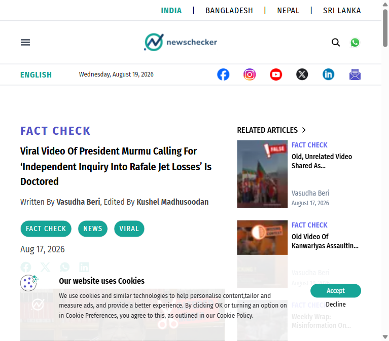
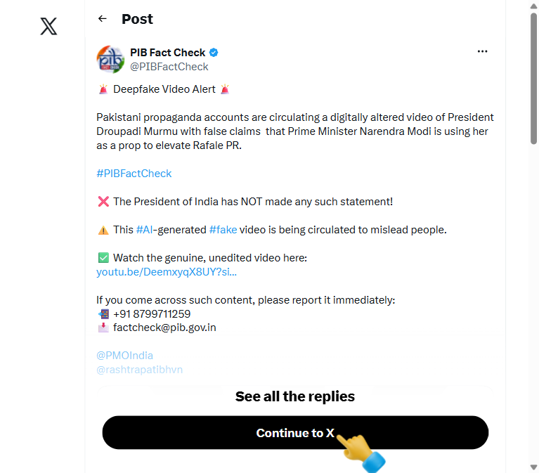
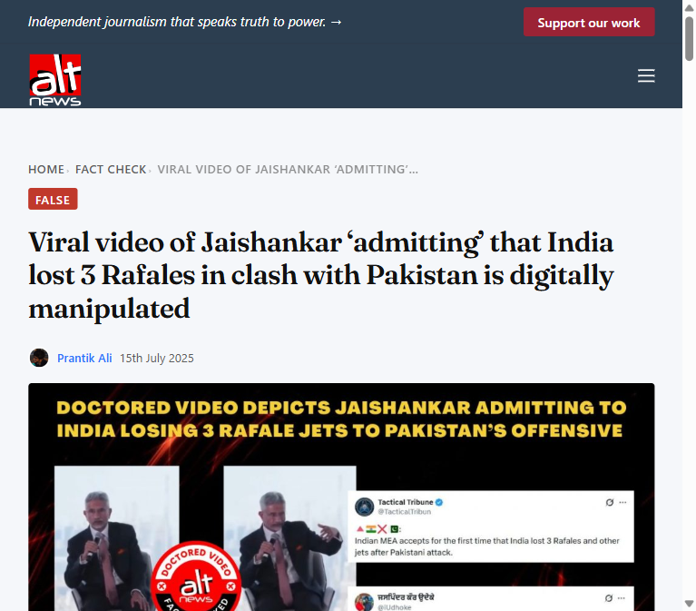

# Incident Documentation — Fabricated Murmu "Independent Commission on Rafale Losses" Video

**Prepared:** 19 Aug 2026 · **Case type:** AI-generated/deepfake video, fabricated quote attributed to the President of India
**Claim under review:** A viral post attributes to President Droupadi Murmu the statement: *"If India has to rise above failures, we must create an independent commission to find out why did India lose Rafales. Only then we can avoid failures."*

---

## 1. Verdict

**FALSE / AI-GENERATED DEEPFAKE.** This is a directly on-point, previously fact-checked incident — Newschecker published a dedicated fact-check of this exact clip two days before this claim was submitted here. President Murmu made no such statement; the video is doctored, with AI-detection tools flagging synthetic audio/video artifacts.

## 2. Evidence collected

### 2.1 Newschecker — direct fact-check of this exact clip

Source: [Newschecker — Viral Video Of President Murmu Calling For 'Independent Inquiry Into Rafale Jet Losses' Is Doctored](https://newschecker.in/fact-check/viral-video-of-president-murmu-calling-for-independent-inquiry-into-rafale-jet-losses-is-doctored) (17 Aug 2026)

This is not a general pattern-match — it is a fact-check of the specific "independent inquiry/commission into Rafale losses" quote circulating now. Newschecker reviewed President Murmu's complete original speech/transcript and found **no mention of Rafale jets or any call for an inquiry**. The viral clip showed unnatural lower-jaw movement consistent with AI lip-sync manipulation, and AI-detection tooling flagged the media as likely synthetic.

### 2.2 PIB Fact Check — official Government of India rebuttal (same target, adjacent fabricated claim)

Source: [@PIBFactCheck on X](https://x.com/PIBFactCheck/status/1983366320482857042)

PIB Fact Check — the Government of India's official fact-checking unit — separately flagged a related deepfake of President Murmu (claiming PM Modi "used her as a prop" for Rafale PR / forced her into the Rafale sortie), tracing it to a genuine India Today clip from a 14 Feb 2025 women's conference that contains no such remarks, and rating it ~90% likely AI-generated. This is a different specific fabricated quote than the "independent commission" one, but the **same target (President Murmu), same subject (Rafale), same modus operandi** (AI voice/lip-sync over unrelated real footage) — confirming this is part of an active, officially-recognized disinformation campaign, not an isolated clip.

### 2.3 Alt News — same broader pattern, different official (S. Jaishankar)

Source: [Alt News — Viral video of Jaishankar 'admitting' that India lost 3 Rafales in clash with Pakistan is digitally manipulated](https://www.altnews.in/viral-video-of-jaishankar-admitting-that-india-lost-3-rafales-in-clash-with-pakistan-is-digitally-manipulated/) (15 Jul 2025)

Establishes that "India lost Rafales" is a recurring fabrication theme, previously run against External Affairs Minister S. Jaishankar with a doctored video and fake quote-tweet overlay, also debunked as digitally manipulated. The Murmu clip is best read as a later variant of the same disinformation narrative, now aimed at the Head of State for added authority.

## 3. Why the claim doesn't hold up

| Check | Result |
|---|---|
| Direct fact-check of this exact clip | Yes — Newschecker, 17 Aug 2026, two days before this claim surfaced. |
| Original speech/transcript review | No mention of Rafale or any inquiry call found anywhere in Murmu's actual remarks. |
| Video/audio forensics | Unnatural jaw movement + AI-detector flags on this clip; ~90% AI-generated score on a related Murmu/Rafale deepfake per PIB Fact Check. |
| Official government response | PIB Fact Check (Government of India) has actively flagged Murmu/Rafale deepfakes as a known Pakistani-propaganda-linked campaign. |
| Protocol plausibility | The President of India is a ceremonial head of state; calling for an "independent commission" into a specific defense operational matter would be a significant break from convention — no such break is corroborated anywhere. |
| Pattern consistency | Matches a recurring "India lost Rafales" fabrication theme previously run against Jaishankar (Alt News, Jul 2025) using the same technique. |

## 4. Files in this folder
- `01_newschecker_murmu_rafale_factcheck.png`
- `02_pibfactcheck_x_post.png`
- `03_altnews_jaishankar_rafale_pattern.png`
- `INCIDENT_DOCUMENTATION_Murmu_RafaleCommission_Deepfake.md` (this file)
- `case-data.md` — case data formatted per `DATA_CHECKLIST.md` for the Sentinel forensic console
