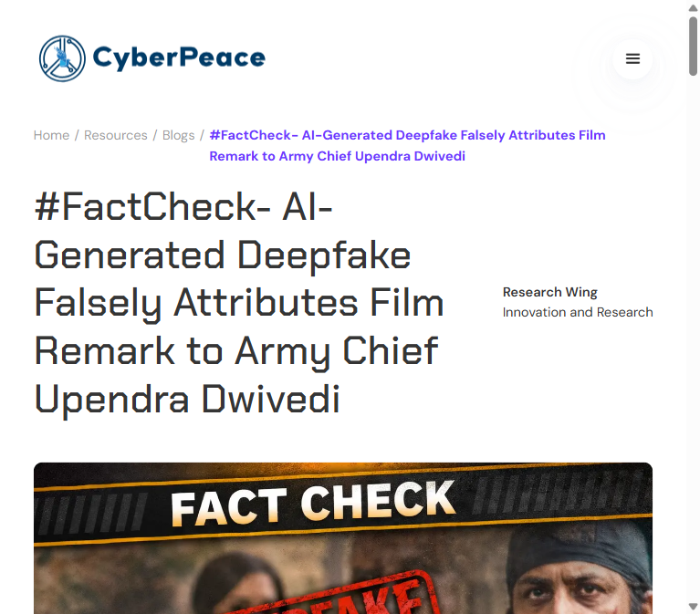
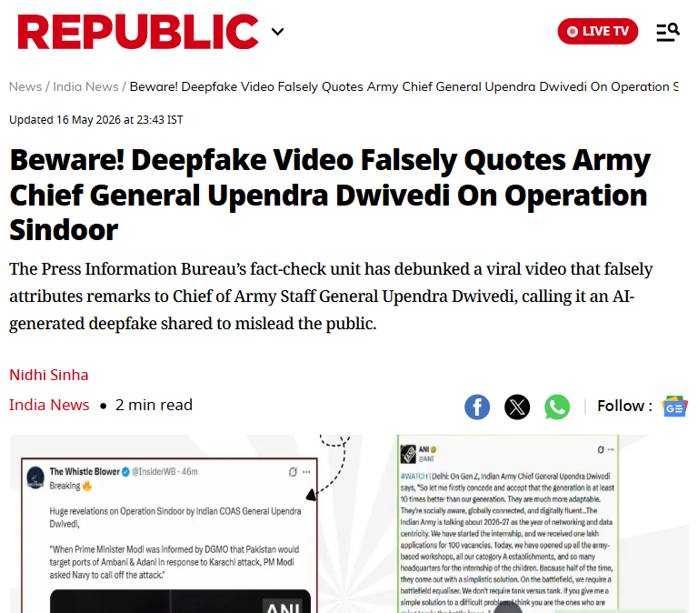
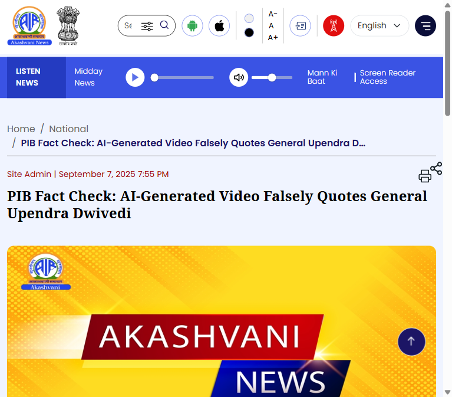

# Incident Documentation — Fabricated Gen. Upendra Dwivedi "Dhurandar 2 / film contacts" Quote

**Prepared:** 19 Aug 2026 · **Case type:** AI-generated deepfake video, fabricated quote attributed to a (now-former) service chief
**Claim under review:** A viral clip attributes to then-Chief of Army Staff Gen. Upendra Dwivedi a request to PM Modi for contacts with filmmaker "Ranjan Agnihotri" to give input/script for a movie referencing "Dhurandar 2" / Operation Sindoor.

---

## 1. Verdict

**FALSE / AI-GENERATED DEEPFAKE.** Directly fact-checked by CyberPeace Foundation's Research Wing. The real, unedited footage is Gen. Dwivedi speaking at the *Ran Samwad* military seminar in Bengaluru about genuine operational aspects of Operation Sindoor — ground intelligence, cyber/electronic warfare inputs, Pakistan's conduct, two-front-scenario challenges. No mention anywhere of PM Modi, any filmmaker, a script, or a movie. AI-detection tooling (DetectVideo AI) returned a 72% AI-generated probability on the clip.

## 2. Evidence collected

### 2.1 CyberPeace Foundation — direct fact-check of this exact quote

Source: [CyberPeace — #FactCheck: AI-Generated Deepfake Falsely Attributes Film Remark to Army Chief Upendra Dwivedi](https://cyberpeace.org/resources/blogs/factcheck--ai-generated-deepfake-falsely-attributes-film-remark-to-army-chief-upendra-dwivedi)

This is the direct match for the specific claim submitted: the "asked PM Modi for film contacts / Dhurandar 2" quote. CyberPeace's Research Wing traced the real *Ran Samwad* seminar footage, confirmed no such remarks exist in it, and ran the viral clip through DetectVideo AI (72% AI-generated probability).

### 2.2 Republic World — same target, same disinformation account, different fabricated quote (pattern evidence)

Source: [Republic World — Beware! Deepfake Video Falsely Quotes Army Chief General Upendra Dwivedi On Operation Sindoor](https://www.republicworld.com/india/beware-deepfake-video-falsely-quotes-army-chief-general-upendra-dwivedi-on-operation-sindoor-2026-05-16-124560) (16 May 2026)

**Important distinction:** the fabricated quote embedded in this specific article is a *different* one — a claim about PM Modi being informed by the DGMO that Pakistan would target Adani/Ambani ports, with Modi allegedly ordering the Navy to call off an attack. It is **not** the "Dhurandar 2/film contacts" quote. What makes this article valuable evidence regardless: the screenshot embedded in it is posted by **@InsiderWB ("The Whistle Blower")** — the same account already documented fabricating Modi/Netanyahu content in case `CHD-2026-00131`. This confirms the same source account is running a pattern of fabricated quotes attributed to senior Indian officials/officers across multiple unrelated narratives.

### 2.3 PIB Fact Check via News On Air (Akashvani) — official Government of India confirmation of the broader pattern

Source: [News On Air — PIB Fact Check: AI-Generated Video Falsely Quotes General Upendra Dwivedi](https://www.newsonair.gov.in/pib-fact-check-ai-generated-video-falsely-quotes-general-upendra-dwivedi) (7 Sep 2025)

**Also a different specific fabricated quote** (this one claims Dwivedi said India lost fighter jets and soldiers during Operation Sindoor) — not the film-contacts claim. Cited here as official-record evidence that the Government of India's own Fact Check Unit has repeatedly and specifically confirmed AI-generated deepfakes targeting Gen. Dwivedi around Operation Sindoor are a recurring, recognized problem, not a one-off.

## 3. Additional facts (from the user's brief, consistent with research)

- Filmmaker **Vivek Ranjan Agnihotri** (not "Ranjan Agnihotri" as garbled in the fake quote) has genuinely announced a film titled *Operation Sindoor*, a T-Series collaboration based on retired Lt. Gen. K.J.S. "Tiny" Dhillon's book — a real project the fabricators appear to have used as raw material to construct a plausible-sounding fake quote.
- Gen. Upendra Dwivedi retired as Chief of Army Staff on 30 June 2026 and was succeeded by Gen. Dhiraj Seth — so the claim is additionally anachronistic if circulated post-retirement while still describing him in an active-COAS context.

## 4. Why the claim doesn't hold up

| Check | Result |
|---|---|
| Direct fact-check of this exact quote | Yes — CyberPeace Foundation. |
| Original seminar footage review | No mention of Modi, any filmmaker, script, or movie anywhere in the real *Ran Samwad* remarks. |
| AI-detection tooling | 72% AI-generated probability (DetectVideo AI) on this clip. |
| Pattern of fabricated quotes re: this same general | Multiple, independently fact-checked (DGMO/ports claim, fighter-jets-lost claim, this film-contacts claim) — a recurring target. |
| Source-account cross-reference | Ties back to @InsiderWB, the same account already documented fabricating content in case `CHD-2026-00131`. |
| Official government confirmation | PIB Fact Check has repeatedly and publicly debunked Dwivedi deepfakes. |
| Real-world anchor exploited | A genuine Agnihotri/T-Series *Operation Sindoor* film announcement was used as the plausible hook for the fake quote. |

## 5. Files in this folder
- `01_cyberpeace_dwivedi_filmremark_factcheck.png` — direct fact-check of this exact quote
- `02_republicworld_dwivedi_factcheck.png` — same target/account pattern, different fabricated quote
- `03_newsonair_pib_dwivedi_factcheck.png` — official GoI confirmation of the broader pattern, different fabricated quote
- `INCIDENT_DOCUMENTATION_Dwivedi_OperationSindoorFilm_Deepfake.md` (this file)
- `case-data.md` — case data formatted per `DATA_CHECKLIST.md` for the Sentinel forensic console
