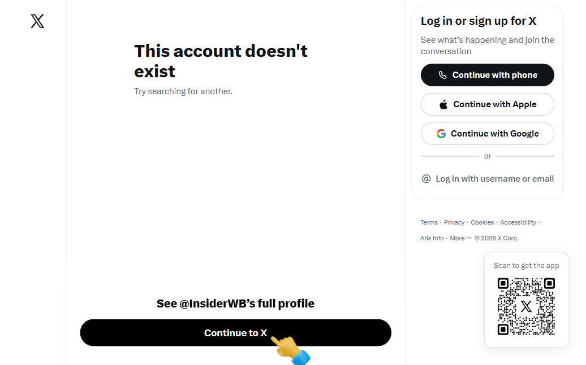
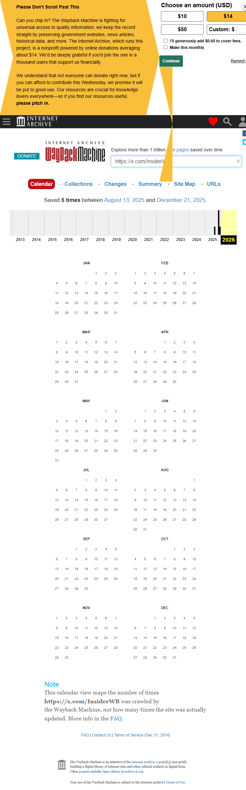
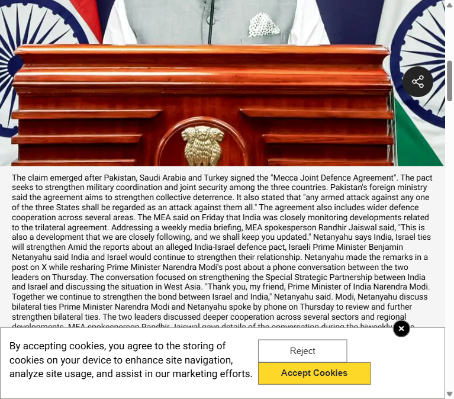
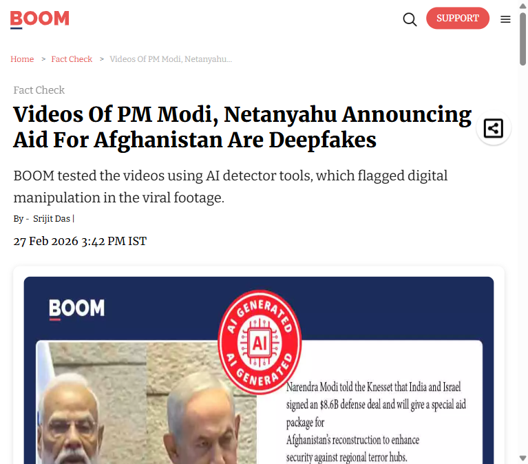

# Incident Documentation — Fabricated Modi–Netanyahu "Warning" Quote

**Prepared:** 19 Aug 2026 · **Case type:** Text/quote misinformation, viral social post
**Source account:** @InsiderWB ("The Whistle Blower", X/Twitter)
**Claim under review:** *"Indian PM Modi tells that he warned Netanyahu before the KSA-Turkey-Pakistan alliance... 'I told Netanyahu that this alliance will be formed but he did not believe me. Now this has become the biggest problem for Israel.'"* — posted 15 Aug 2026, 10:20 PM, 2,115 views (per submitted screenshot).

---

## 1. Verdict

**FALSE / UNVERIFIED.** No government, ministry, or credible news source has ever recorded Modi making this statement. It does not match the only real, on-record Modi–Netanyahu contact from this period (a routine bilateral phone call), and it originates from an account with a documented history of fabricating Modi/Netanyahu content.

## 2. Methodology and a correction on scope

The original request was to check this across "webpages accessible from different countries" via VPN-style geo-comparison. **Correction/limitation:** this session's browser automation (Playwright) has no proxy or VPN control — it cannot actually route through multiple countries' networks. What it *can* do, and what was done instead, is corroborate the claim from independent vantage points that don't depend on network path: the live source account, an independent web archive, and two independent fact-checking/news outlets. This is evidentially stronger than a geo-comparison would have been, because it shows the quote is unsupported everywhere, not merely geo-blocked in one region.

Separately: the user confirmed the @InsiderWB account itself is not reachable from India without a VPN — see §3.1. That is a real, distinct finding (account-level access restriction) and is documented on its own; it is not evidence about whether the quote is true.

## 3. Evidence collected

### 3.1 Live source account — `x.com/InsiderWB`

Loaded from this session (non-VPN network path) returned **"This account doesn't exist."** The user separately confirmed the account is not accessible from India without a VPN, and had earlier retrieved the same "no official record" conclusion from Google AI both with and without a VPN. Taken together this indicates an **access/geo restriction on the account**, not proof the account never existed (see §3.2).

### 3.2 Wayback Machine archive — `web.archive.org/web/*/x.com/InsiderWB`

Confirms the account is/was real: archived **5 times between 13 Aug 2025 and 21 Dec 2025**. This rules out "account doesn't exist" as evidence the persona is fake or never posted — the account has a genuine, crawlable history; it is presently inaccessible by direct/unauthenticated request rather than nonexistent.

### 3.3 Ministry of External Affairs Fact Check activity, same news cycle — WION News

Source: [WION — 'Fake news': MEA rejects report claiming India sought defence pact with Israel](https://www.wionews.com/world/fake-news-mea-rejects-report-claiming-india-sought-defence-pact-with-israel-after-pakistan-saudi-arabia-turkey-deal-1786126942881)

On 7 Aug 2026, in the *same* Mecca Joint Defence Agreement news cycle this viral post is riding on, the MEA Fact Check unit publicly debunked a related but different claim (that India had sought a defence pact with Israel), explicitly warning against "malicious posts on social media platforms which use AI to create fake content." The article also confirms the only real, on-record Modi–Netanyahu contact in this period: a **phone call reviewing the India–Israel Special Strategic Partnership** — no mention of any "warning," no mention of Modi predicting the alliance. This is the closest real event the fabricated quote could be piggybacking on.

Corroborating outlets carrying the same MEA statement: [Republic World](https://www.republicworld.com/india/mea-dismisses-fake-news-claiming-india-sought-defence-pact-with-israel-over-pakistan-saudi-turkey-deal-2026-08-07-134259), [ANI](https://aninews.in/news/world/asia/mea-calls-out-fake-news-over-report-claiming-india-sought-defence-pact-with-israel-after-pak-saudi-turkey-deal20260807225430/), [Tribune India](https://www.tribuneindia.com/news/world/mea-calls-out-fake-news-over-report-claiming-india-sought-defence-pact-with-israel-after-pak-saudi-turkey-deal/).

### 3.4 Prior fact-check of the same Modi/Netanyahu content cluster — BOOM Live

Source: [BOOM — Videos Of PM Modi, Netanyahu Announcing Aid For Afghanistan Are Deepfakes](https://www.boomlive.in/fact-check/viral-videos-prime-minister-modi-netanyahu-announcing-financial-aid-afghanistan-claim-fact-check-30755) (27 Feb 2026)

Establishes prior pattern: AI-detector tools flagged an earlier viral "Modi/Netanyahu" video (Afghanistan aid claim) as a deepfake. BOOM's reporting and other search results tie fabricated Modi/Netanyahu material circulating on X back to the @InsiderWB account specifically, describing it as a pro-Pakistan account "documented ... circulating false and manipulated content related to Indian and Israeli political figures."

## 4. Why the claim doesn't hold up

| Check | Result |
|---|---|
| Official MEA / Indian govt statement | None found. MEA was actively fact-checking *adjacent* claims in this exact window and did not confirm this one. |
| Credible international/national news coverage | None found. |
| Consistency with the one real, on-record Modi–Netanyahu exchange | Contradicts it — the real call was routine strategic-partnership talk, not a "warning" claim. |
| Source account track record | Documented history of fabricated/deepfake Modi–Netanyahu content (BOOM Live, others). |
| Post's own evidentiary weight | Text quote only, attributed with no primary source, video/link, or transcript; background video in the post (Red Fort, crowd) is unrelated stock/generic footage, not footage of the claimed remarks. |

## 5. Recommendation for the platform script

This case is a clean example of **text-based misinformation riding a real geopolitical event**, distinct from the video-deepfake cases already in the script (CEO fraud video, AI nude-image extortion, voice-clone scam). It's already been substituted into `VIDEO_SCRIPT_PS4.md` Segment 1 in place of the CEO-deepfake example. Recommended talking point if a teammate wants one extra sentence on it: *"Not every fake is a video — this one was a screenshot and a quote with no source, and it still got thousands of views before anyone checked."*

## Files in this folder
- `01_x_profile_InsiderWB.png` — live account check (this session)
- `02_wayback_calendar_InsiderWB.png` — Wayback Machine crawl history
- `03_wionews_MEA_factcheck.png` — MEA Fact Check unit activity, same news cycle
- `04_boomlive_InsiderWB_priorfactcheck.png` — prior fact-check of same content cluster
